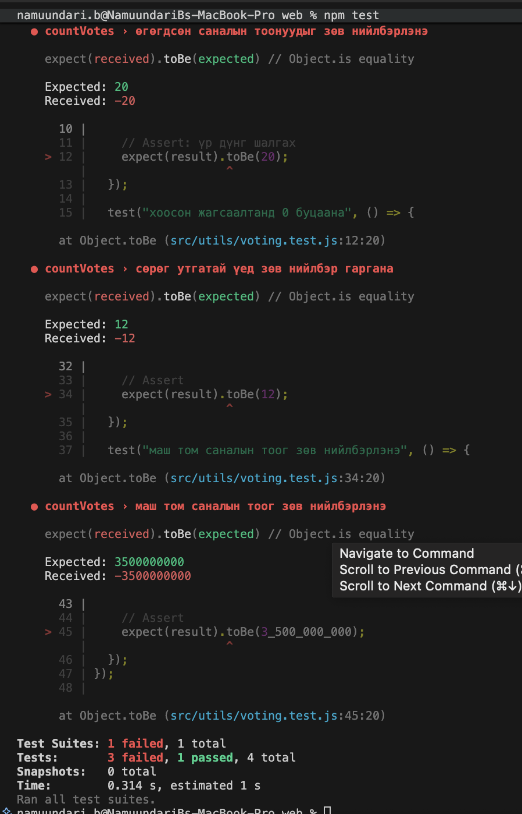
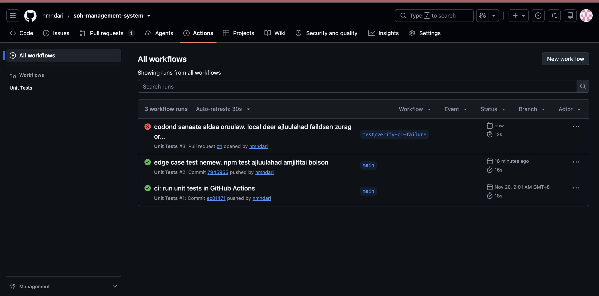
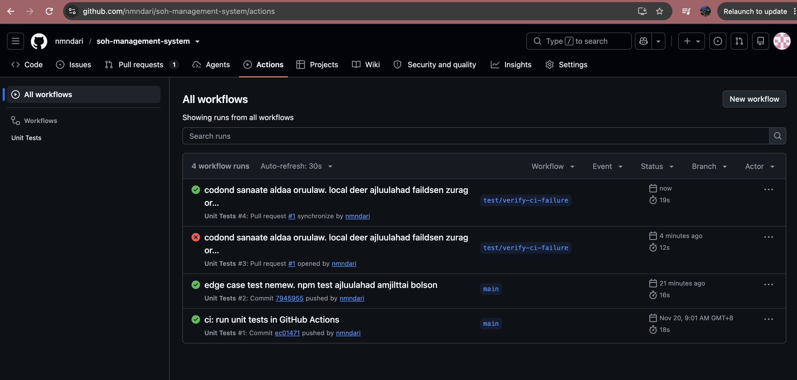

 # СӨХ УДИРДЛАГЫН СИСТЕМ

СӨХ-ийн өдөр тутмын үйл ажиллагааг цахимжуулах, оршин суугчид болон СӨХ-ийн удирдлагын хоорондын харилцаа холбоог сайжруулах, санхүүгийн мэдээллийн ил тод байдлыг хангах зориулалттай систем.

## 1. Төслийн танилцуулга

Тус систем нь дараах үндсэн гурван хэсгээс бүрдэнэ.

- **Веб аппликейшн (React.js):** СӨХ-ийн администратор оршин суугчдын мэдээлэл, зардал, зарлал, хурал, санал асуулга болон санал гомдлыг удирдана.
- **Гар утасны аппликейшн (Flutter):** Оршин суугчид мэдээлэл авах, мэдэгдэл хүлээн авах, санал асуулгад оролцох, санал гомдол илгээх боломжтой.
- **Сервер тал (Node.js + Express.js):** Веб болон гар утасны аппликейшний хүсэлтийг боловсруулж, бизнес логикийг хэрэгжүүлэн өгөгдлийн сантай холбож ажиллана.

## 2. Ашиглах технологиуд

| Хэсэг | Технологи |
|---|---|
| Веб интерфейс | React.js |
| Хөгжүүлэлтийн орчин | Vite |
| Програмчлалын хэл | JavaScript |
| Хуудас хоорондын шилжилт | React Router |
| Дүрс тэмдэг | Lucide React |
| Гар утасны аппликейшн | Flutter |
| Сервер тал | Node.js + Express.js |
| Өгөгдлийн сан | PostgreSQL |
| Автомат UI тест | Playwright |
| Ачааллын тест | k6 |
| Хувилбарын удирдлага | Git + GitHub |
| Тасралтгүй интеграц ба хүргэлт | GitHub Actions |

## 3. Төслийг локал орчинд ажиллуулах

### 3.1. Шаардлагатай програм хангамж

Төслийг ажиллуулахын өмнө дараах програмуудыг суулгасан байна:

- [Node.js](https://nodejs.org/)
- [Git](https://git-scm.com/)
- [Visual Studio Code](https://code.visualstudio.com/)

Суулгасан хувилбарыг шалгах:

```bash
node -v
npm -v
git --version
```

### 3.2. Төслийг татаж авах

GitHub дээр байршуулсан төслийг локал компьютерт татаж авна.

```bash
git clone <GITHUB_REPOSITORY_URL>
```

Төслийн үндсэн хавтас руу шилжих:

```bash
cd soh-management-system
```

### 3.3. Веб аппликейшнийг ажиллуулах

Веб аппликейшний хавтас руу шилжинэ.
```bash
cd web
```
Шаардлагатай сангуудыг суулгана.

```bash
npm install
```

Хөгжүүлэлтийн серверийг ажиллуулна.
```bash
npm run dev
```

Амжилттай ажилласан тохиолдолд терминал дээр дараах хаяг харагдана.

```text
http://localhost:5173/
```

Уг хаягийг веб хөтөч дээр нээж аппликейшнийг ашиглана.

**Анхаарах зүйл:** Веб аппликейшнийг анх удаа ажиллуулахдаа `npm install` командыг заавал ажиллуулна. Харин дараагийн удаа зөвхөн `npm run dev` командыг ажиллуулахад хангалттай.

## 4. Ашиглах командууд

Дараах командуудыг `web/` хавтас дотор ажиллуулна.

| Команд | Тайлбар |
|---|---|
| `npm install` | Шаардлагатай сангуудыг суулгах |
| `npm run dev` | Хөгжүүлэлтийн сервер ажиллуулах |
| `npm run build` | Веб аппликейшнийг production хувилбар болгон бүтээх |
| `npm run preview` | Бүтээсэн хувилбарыг локал орчинд шалгах |
| `npm run lint` | Кодын чанар, алдааг шалгах |
| `npm test` | Jest unit тестүүдийг ажиллуулах |

**Тайлбар:** Одоогийн веб хувилбарын зарим мэдээлэл нь туршилтын жишээ өгөгдөл бөгөөд түр хугацаанд React-ийн state ашиглан хадгалагдаж байна. Сервер талын нэвтрэлт баталгаажуулалт, API холболт болон өгөгдлийн санд хадгалах боломжуудыг дараагийн хөгжүүлэлтийн үе шатанд хэрэгжүүлнэ.

## 5. Лекц 11: Unit тест ба CI pipeline

### Тестлэсэн функц

`web/src/utils/voting.js` файл дахь `countVotes(votes)` функц нь саналын тоонуудын массивыг авч, нийт дүнг буцаадаг pure function юм.

### AAA зарчим

Бүх unit тест нь дараах AAA бүтэцтэй.

- **Arrange:** Тестийн жишиг өгөгдлийг бэлдэх.
- **Act:** `countVotes` функцийг дуудах.
- **Assert:** Буцсан үр дүн хүлээгдэж буй утгатай тэнцэж байгаа эсэхийг шалгах.

Тестүүд `web/src/utils/voting.test.js` файлд байрлана.

| Ангилал | Тестийн тохиолдол | Хүлээгдсэн үр дүн |
|---|---|---|
| Хэвийн | `[4, 7, 9]` | `20` |
| Хэвийн | `[8]` | `8` |
| Edge case | `[]` | `0` |
| Edge case | `[10, -3, 5]` | `12` |
| Edge case | `[1_000_000_000, 2_000_000_000, 500_000_000]` | `3_500_000_000` |

`countVotes` нь API, өгөгдлийн сан, эсвэл өөр гаднын сервис дуудахгүй. Иймээс энэ сонгосон функцийн тестүүдэд mock шаардлагагүй; тест нь зөвхөн тооцооллын логикийг тусгаарлан шалгана.

### Локал тест ажиллуулах

```bash
cd web
npm ci
npm test
```

### CI pipeline

GitHub Actions-ийн тохиргоо `.github/workflows/test.yml` файлд бий. `main` branch руу push хийх болон `main` руу нээсэн pull request бүр дээр дараах алхмууд автоматаар ажиллана:

1. Source code авах
2. Node.js 20 тохируулах
3. `npm ci` ашиглан dependency суулгах
4. `npm test` ажиллуулах

### CI амжилттай ажилласан нотолгоо

GitHub Actions ашиглан CI pipeline-ийн ажиллагааг туршсан. Эхний туршилтаар кодонд санаатай алдаа оруулж, Pull Request үүсгэхэд автомат тест амжилтгүй болсон. Үүний дараа алдааг засаж, шинэ commit push хийхэд GitHub Actions дахин ажиллан бүх unit тест амжилттай болсон. Ингэснээр CI pipeline нь кодын өөрчлөлтийг автоматаар шалгаж, алдааг илрүүлэх боломжтойг баталгаажуулсан.

#### Локал тест унасан үе



#### Pull Request дээр CI унасан үе



#### Засварын дараах амжилттай CI



## Суулгах
npm install recharts
